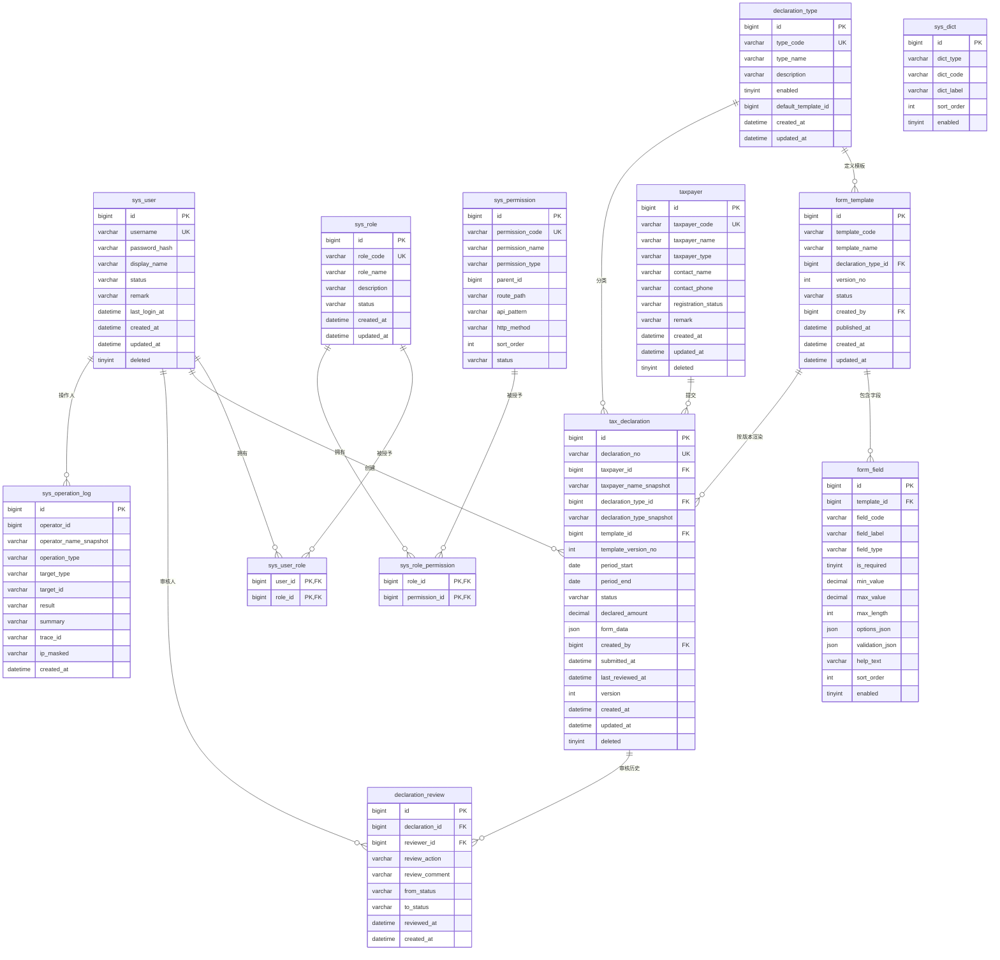

# 数据库设计（V1.0）

> 数据库：MySQL 8.0 系列（本机验证环境为 MySQL 9.0.1）
> 字符集/引擎：`utf8mb4` / `InnoDB`
> 迁移：Flyway `V1__init_schema.sql`、`V2__seed_demo_data.sql`
> 所有业务数据均为教学用虚构数据。

## 1. ER 图



## 2. 表清单与职责

| 表 | 职责 | 关键约束/索引 |
| -- | ---- | ------------- |
| `sys_user` | 登录账号、BCrypt 密码、状态、逻辑删除 | `uk_sys_user_username`，`idx_sys_user_status` |
| `sys_role` | 角色（ADMIN/CLERK/REVIEWER/ANALYST/VIEWER） | `uk_sys_role_code` |
| `sys_permission` | 菜单/API 权限；`MENU` 带路由，`API` 带接口模式与方法 | `uk_sys_permission_code` |
| `sys_user_role` | 用户–角色多对多 | 复合主键，双向外键索引 |
| `sys_role_permission` | 角色–权限多对多 | 复合主键，双向外键索引 |
| `taxpayer` | 虚构纳税人档案 | `uk_taxpayer_code`，名称/类型+状态索引，逻辑删除 |
| `declaration_type` | 模拟申报类型 | `uk_declaration_type_code`，`enabled` |
| `form_template` | 模板版本；`DRAFT/PUBLISHED/DISABLED` | `uk_form_template_code_version`，类型+状态索引 |
| `form_field` | 模板字段定义与校验元数据 | `uk_form_field_code(template_id, field_code)` |
| `tax_declaration` | 申报主表 + 快照 + JSON 表单值 + 乐观锁 | 编号唯一；纳税人/类型/期间/状态复合索引；状态+提交时间；创建人+时间 |
| `declaration_review` | 每次审核一条，含前后状态 | 申报+审核时间、审核人+时间 |
| `sys_operation_log` | 审计日志，只读 | 时间、操作人+时间、类型+时间 |
| `sys_dict` | 基础字典 | `uk_sys_dict_type_code` |

## 3. 设计要点

### 3.1 权限模型

- 用户与角色多对多，角色与权限多对多。
- 权限分两类：`MENU`（`route_path` 驱动前端菜单）与 `API`（`api_pattern` + `http_method` 记录接口归属，后端实际以 `@PreAuthorize` 编码为准）。
- 角色停用不删除历史绑定；用户逻辑删除保留审计关联。
- 演示角色权限范围见 `V2__seed_demo_data.sql`；ADMIN 拥有全部 31 项权限。

### 3.2 模板版本不可变

- `form_template` 以 `(template_code, version_no)` 唯一。
- 发布后禁止原位修改字段；修改必须 `new-version` 生成新草稿。
- `tax_declaration` 同时保存 `template_id` 与 `template_version_no`，历史申报按原字段定义渲染。

### 3.3 申报快照

`tax_declaration` 冗余保存：

- `taxpayer_name_snapshot`、`declaration_type_snapshot`：主体/类型改名后历史申报仍可读。
- `form_data`（JSON）：提交时的动态字段值。
- `declared_amount DECIMAL(18,2)`：统计与排序专用，禁止浮点。
- `version INT`：MyBatis-Plus 乐观锁，防止并发覆盖。

### 3.4 状态机与并发

```
DRAFT --submit--> PENDING_REVIEW --approve--> APPROVED
  ^                    |    |
  |                    |    +--withdraw--> WITHDRAWN
  +------edit------- RETURNED <--return-----+
```

- 状态变更使用 `UPDATE ... WHERE id=? AND status=?`，影响行数为 0 返回 `409`。
- 审核与 `declaration_review` 插入在同一 `@Transactional` 中。
- 重复申报规则：同一 `taxpayer_id + declaration_type_id + period_start + period_end`，在 `DRAFT/PENDING_REVIEW/APPROVED` 状态下只允许一条；服务层校验 + 查询索引兜底。

### 3.5 审计与隐私

- 操作日志记录操作人快照、动作、对象、结果、`trace_id`、掩码 IP。
- 不写密码、Token、完整请求体；日志表无更新/删除接口。
- 演示密码统一 `Demo@1234`，仅存 BCrypt 哈希；种子数据全部虚构。

### 3.6 删除策略

- `sys_user`、`taxpayer`、`tax_declaration` 使用 `deleted` 逻辑删除。
- 已有申报的纳税人拒绝物理删除，提示改用停用。
- 模板/字段/审核/日志不做物理删除。

## 4. 种子数据概览

| 内容 | 数量 | 说明 |
| ---- | ---- | ---- |
| 角色 | 5 | ADMIN、CLERK、REVIEWER、ANALYST、VIEWER |
| 权限 | 31 | 11 菜单 + 20 API |
| 用户 | 5 | `admin`、`clerk`、`reviewer`、`analyst`、`viewer`，密码 `Demo@1234` |
| 纳税人 | 6 | 企业/个人/其他，含 1 个停用主体 |
| 申报类型 | 3 | 综合、经营、个人模拟类型 |
| 表单模板 | 3 | 均为 `PUBLISHED` V1 |
| 模板字段 | 15 | 覆盖 7 种字段类型 |
| 申报 | 8 | 覆盖 5 种状态 |
| 审核记录 | 4 | 通过 3 条、退回 1 条 |
| 操作日志 | 3 | 提交、退回、通过示例 |
| 字典 | 8 | 状态、类型等标签 |

## 5. 迁移与重置

- 启动时 Flyway 自动执行未应用的迁移；已应用版本记录在 `flyway_schema_history`。
- 测试库 `tax_business_test` 由 `TestDatabaseConfig` 在测试上下文启动时 `clean + migrate`，每次测试从固定种子开始；**该操作会清空测试库，禁止指向开发库**。
- 重置演示库：

```sql
DROP DATABASE IF EXISTS tax_business;
CREATE DATABASE tax_business CHARACTER SET utf8mb4 COLLATE utf8mb4_0900_ai_ci;
-- 重启后端，Flyway 重新执行 V1/V2
```

## 6. 已知限制

- 统计中以 `period_start` 归月，跨月申报按起始月计入。
- 表单 JSON 使用 MySQL `JSON` 类型，未建立 JSON 内部索引；V1 数据规模下可接受。
- 未实现数据库级“有效申报唯一”约束（条件唯一索引不适用于多状态组合），由事务内服务校验 + 索引查询兜底。
