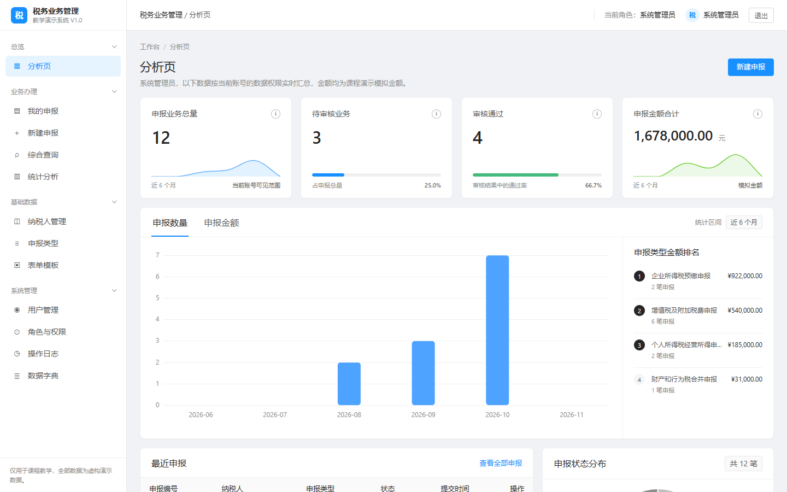

# 税务业务管理系统（传统 Java EE 版）

基于 **Struts 6 + JSP/JSTL + JDBC + MySQL** 的传统 Java EE 课程设计项目，部署于 Apache Tomcat 9。系统覆盖纳税人管理、动态表单模板、申报流转、审核、统计、综合查询与操作审计，全部业务数据均为虚构演示数据。

传统版固定使用 `javax.servlet` 命名空间，**不使用任何 `jakarta.*` API**；请求入口是真正的 Struts `Action`，路由、拦截器与视图结果由 `struts.xml` 管理。



## 1. 技术栈

| 层次 | 技术 | 版本/约束 |
| --- | --- | --- |
| Web 容器 | Apache Tomcat | 9.0.x（测试使用 9.0.123） |
| Web MVC | Apache Struts | 6.12.0，基于 `javax.servlet`，**不使用 Struts 7 / Jakarta** |
| Servlet/JSP | `javax.servlet` / JSP | Servlet 4.0 / JSP 2.3，**不使用 Jakarta** |
| 视图 | JSP + JSTL 1.2 + EL | 仅展示，无 SQL、无 Java 脚本片段 |
| 控制器 | Struts Action + Filter | `ActionSupport`、XML 路由、全局 JSP Result |
| 业务 | Java Service | 事务、权限、状态机 |
| 持久层 | JDBC + PreparedStatement | 无 ORM、无 MyBatis |
| 数据库 | MySQL | 8.0+，InnoDB，utf8mb4 |
| 连接池 | HikariCP | 4.0.3 |
| 密码 | BCrypt（jbcrypt） | cost 10 |
| JSON | Gson | 动态表单与图表数据 |
| 前端 | Bootstrap 5.3 + 原生 JS + Chart.js | 静态资源本地化 |
| 构建 | Maven WAR | `maven.compiler.release=11` |
| 测试 | JUnit 5 + H2 | H2 2.2.224 MySQL 模式 |

禁止项确认：未使用 Spring Boot、Vue、React、MyBatis、Hibernate、JPA，未混用 `javax`/`jakarta`，未使用 Tomcat 10+，也未使用面向 Jakarta 的 Struts 7。

## 2. 功能模块

1. **工作台**：申报总数、待审核、通过数、金额合计、草稿/退回/撤回、趋势图、状态环图、类型金额、最近申报。
2. **用户与权限**：登录页自助注册（默认只读访客）、用户增改、启停、重置密码；角色-权限多对多；URL 粗过滤 + Service 细校验。
3. **纳税人**：档案增改、搜索、启停；停用后禁止新建申报。
4. **申报类型**：编码、名称、截止日、启停。
5. **表单模板**：动态字段（文本/整数/金额/日期/单选/多选/布尔）、预览、发布、停用、版本复制。
6. **申报管理**：草稿保存、提交、撤回、退回后修改重提、详情与模板版本快照。
7. **审核**：待审核列表、通过、退回（意见必填）、审核历史、禁止自审、并发冲突提示。
8. **统计分析**：6/12 个月趋势、状态分布、按类型/主体类型金额、通过率。
9. **综合能力**：组合查询、CSV 导出（BOM、公式注入防护）、操作日志、数据字典、个人改密。

## 3. 快速开始

### 3.1 一键 Docker 启动（推荐）

前置条件只有 Docker Desktop。项目根目录双击：

```text
START.bat
```

也可以运行：

```powershell
docker compose up -d --build
```

脚本会自动构建 WAR，启动 MySQL 8 与 Tomcat 9，首次启动自动导入 `schema.sql` 和 `seed-demo.sql`，等待 Struts 登录页可用后打开浏览器。

登录页包含“账号登录 / 注册账号 / 角色说明”三个并列页签。新注册账号默认获得只读访客权限。

| 项目 | 默认值 |
| --- | --- |
| 访问地址 | <http://localhost:18082> |
| 容器 | `tax-jee-mysql`、`tax-jee-app` |
| 数据库卷 | `tax-business-jee-mysql-data` |
| 修改端口 | 复制 `.env.docker.example` 为 `.env`，修改 `APP_PORT` |

18082 刻意与旁边的 Spring Boot 版默认端口 18080 错开，两个版本可以同时启动。停止和查看日志分别使用 `docker-stop.bat`、`docker-logs.bat`；`docker compose down` 不会删除数据库卷。

### 3.2 本地前置条件

- JDK 11 或更高（本项目以 Java 11 字节码为目标，实测 JDK 23 构建/运行）
- Maven 3.6+
- MySQL 8.0+
- Apache Tomcat 9.0.x

> 不要把项目部署到 Tomcat 10/11：它们使用 `jakarta.*` 命名空间，与本项目的 `javax.servlet` 不兼容。

### 3.3 初始化数据库

```bash
mysql -u root -p < database/schema.sql
mysql -u root -p tax_demo < database/seed-demo.sql
```

建议创建独立应用账号（示例，密码请自行替换，禁止提交真实密码）：

```sql
CREATE USER 'tax_app'@'localhost' IDENTIFIED BY 'replace-with-strong-password';
GRANT SELECT, INSERT, UPDATE, DELETE ON tax_demo.* TO 'tax_app'@'localhost';
FLUSH PRIVILEGES;
```

### 3.4 配置数据库连接

方式一（推荐本地开发）：复制示例文件后修改，`db.properties` 已被 `.gitignore` 忽略。

```bash
cp src/main/resources/db.properties.example src/main/resources/db.properties
# 编辑 db.properties：db.url / db.username / db.password
```

方式二（不改包，通过 JVM 参数）：

```bash
export CATALINA_OPTS="-Dtax.db.url=jdbc:mysql://localhost:3306/tax_demo?useUnicode=true&characterEncoding=UTF-8&serverTimezone=Asia/Shanghai&useSSL=false&allowPublicKeyRetrieval=true \
-Dtax.db.username=tax_app -Dtax.db.password=your-password -Dtax.db.driver=com.mysql.cj.jdbc.Driver"
```

优先级为 JVM 系统属性 → `TAX_DB_*` 环境变量 → `db.properties`。Docker 使用环境变量注入连接信息。不要在生产环境使用 `allowPublicKeyRetrieval=true` 配合弱口令；生产应启用 TLS 并用密钥管理保存凭据。

### 3.5 构建与部署

```bash
mvn clean package
# 产物：target/tax-business-system.war
cp target/tax-business-system.war $CATALINA_HOME/webapps/
$CATALINA_HOME/bin/startup.sh    # Windows: startup.bat
```

访问：`http://localhost:8080/tax-business-system/`

若部署为 `ROOT.war`，访问 `http://localhost:8080/`。

### 3.6 演示账号

| 账号 | 密码 | 角色 | 主要权限 |
| --- | --- | --- | --- |
| `admin` | `Admin@123` | 系统管理员 | 用户/角色/字典/审计、基础数据，**无审核权限** |
| `clerk1` | `Clerk@123` | 业务经办人 | 纳税人查看、申报新建/提交/撤回 |
| `reviewer1` | `Reviewer@123` | 审核人员 | 待审核、通过/退回 |
| `analyst1` | `Analyst@123` | 数据分析 | 统计、综合查询、导出 |
| `viewer1` | `Viewer@123` | 只读用户 | 工作台、只读查询 |
| `disabled1` | `Disabled@123` | 已停用 | 无法登录（用于验证停用逻辑） |

以上均为演示账号，密码以 BCrypt 摘要存储。**首次部署后应立即修改或删除演示账号。**

登录页提供测试账号快捷登录区：点击角色卡片会填写对应账号并提交原有登录表单，CSRF、账号状态与权限校验仍然生效。该区域只适合课程演示环境，正式部署应移除。

## 4. 项目结构

```text
tax-business-system/
├── database/
│   ├── schema.sql              # MySQL 8 建库/建表
│   └── seed-demo.sql           # 虚构演示数据
├── docs/
│   ├── development-document-v1.0.md
│   ├── ui-reference-research.md
│   ├── database-design.md
│   ├── api-route-list.md
│   ├── test-plan.md
│   ├── changelog.md
│   └── screenshots/
├── src/main/java/com/example/tax/
│   ├── action/                 # Struts Action，BaseAction 统一异常与结果处理
│   ├── dao/                    # JDBC DAO，try-with-resources
│   ├── dto/                    # 查询条件、分页、表单 DTO
│   ├── exception/              # 业务/校验/权限异常
│   ├── filter/                 # EncodingFilter、AuthFilter
│   ├── model/                  # 实体
│   ├── security/               # SessionUser、CSRF、权限编码
│   ├── service/                # 业务与事务
│   └── util/                   # Db、WebUtil、CsvUtil、DateUtil
├── src/main/resources/
│   ├── struts.xml              # Struts 命名空间、Action 与 JSP Result
│   └── db.properties.example
├── src/main/webapp/
│   ├── assets/                 # 本地 Bootstrap/Chart.js/CSS/JS
│   └── WEB-INF/views/          # JSP（外部不可直接访问）
├── src/test/                   # JUnit 5 + H2
├── Dockerfile                  # Maven 多阶段构建 + Tomcat 9
├── compose.yaml                # Tomcat 9 + MySQL 8
├── START.bat                   # Windows 一键启动
├── scripts/start-docker.ps1    # 启动、等待、健康检查与日志提示
└── pom.xml
```

## 5. 架构与请求链路

```text
Browser
  → EncodingFilter（UTF-8、TraceId、安全响应头）
  → AuthFilter（登录态、URL 权限、CSRF、会话）
  → StrutsPrepareAndExecuteFilter
  → Action（参数转换、调用 Service、选择 JSP Result 或 PRG 重定向）
  → Service（权限、校验、事务、状态机）
  → DAO（JDBC PreparedStatement）
  → MySQL
  → JSP（JSTL/EL 只渲染）
```

- JSP 全部位于 `WEB-INF/views`，不能通过 URL 直接访问。
- 所有业务入口统一使用 `.action` 后缀，由 `struts.xml` 按命名空间映射。
- `BaseAction` 只允许服务端代码设置 `resultView`，全局 Struts Result 再渲染 `/WEB-INF/views/*.jsp`。
- GET 只读；所有状态变更使用 POST + CSRF + 302 重定向。
- 会话只保存用户身份与权限快照；不信任客户端传入的角色。
- 登录成功后 `changeSessionId()` 防会话固定；退出 `invalidate()`。
- 错误页只显示追踪号，不输出堆栈、SQL 或服务器路径。

## 6. 测试

```bash
mvn clean test
```

实际结果：**30 个 Service/Util 测试全部通过，0 失败、0 错误、0 跳过**。

测试使用 H2 内存库的 MySQL 兼容模式，每个测试重建 schema 与种子数据，覆盖登录、权限、纳税人、申报状态机、审核、统计、查询、审计、CSV 转义。详见 `docs/test-plan.md`。

Docker 冒烟验证已经覆盖：MySQL 8 自动建表/种子数据、Tomcat 9.0.123 部署、五个角色登录、23 个主要业务页面、CSV 导出，以及运行依赖中没有 Jakarta Servlet/JSP API JAR。

Jakarta 边界说明：本项目源码、`web.xml`、Tomcat、Servlet/JSP API 均使用 `javax.*`。Struts 6.12 间接依赖的 FreeMarker 包内带有未启用的 `ext.jakarta` 兼容类，但本项目不引用该类，也没有 `jakarta.servlet` API 或 Jakarta 容器；不要升级到 Struts 7 或 Tomcat 10+。

## 7. 安全设计要点

- BCrypt 存储密码；登录失败统一提示，避免账号枚举；停用账号拒绝登录。
- CSRF Token 存于 Session，POST 常量时间比较；缺失/错误返回 403。
- 所有 SQL 使用 PreparedStatement；动态查询只拼接固定的 `WHERE` 片段，值全部绑定。
- 输出统一使用 `<c:out>` 或 JSTL 转义；动态表单选项来自受控模板。
- 服务端二次权限校验：审核人不能审核自己创建的申报；分析师无录入权限；管理员默认无审核权限。
- 审计日志不记录密码、Cookie、Session ID、完整敏感表单，仅记录操作类型、对象、结果、追踪号。
- CSV 导出限制 5000 行，对公式前缀做转义。
- CSP、`X-Content-Type-Options`、`X-Frame-Options`、`Referrer-Policy` 由过滤器统一设置。

## 8. 已知限制

1. 未做多浏览器、移动端真机、性能压测与专业渗透测试。
2. 未接入真实税务接口、邮件/短信、单点登录。
3. 表单错误提示为顶部提示 + 字段内联，未实现 GOV.UK 式错误摘要锚点跳转与自动聚焦。
4. 统计在应用层按当前数据范围计算，数据量大时应改为数据库聚合与缓存。

## 9. 文档索引

- [开发文档 V1.0](docs/development-document-v1.0.md)
- [UI 参考调研](docs/ui-reference-research.md)
- [数据库设计](docs/database-design.md)
- [路由与接口清单](docs/api-route-list.md)
- [测试计划与结果](docs/test-plan.md)
- [变更记录](docs/changelog.md)

## 10. 常见问题

**启动报 `ClassNotFoundException: javax.servlet.*`**  
部署到了 Tomcat 10/11。请使用 Tomcat 9.x。

**手动输入路由后返回 404**  
本版业务入口使用 Struts 动作后缀，例如 `/auth/login.action`、`/dashboard.action`。不要使用旧 Servlet 的无后缀路径。

**Docker 首次启动较慢**  
首次需要构建 WAR 并初始化 MySQL。再次执行 `START.bat` 会复用 Maven 缓存和数据库卷；修改 Java/JSP 后脚本会重新构建应用镜像。

**需要彻底重置 Docker 数据**  
`docker compose down -v` 会删除 `tax-business-jee-mysql-data`，下一次启动重新导入演示数据。该操作不可恢复。

**页面 500，日志提示数据库连接失败**  
检查 `db.properties` 是否在 `WEB-INF/classes` 下，或 JVM 参数是否正确；确认 MySQL 用户对 `tax_demo` 有权限，且 URL 的时区/SSL 参数正确。

**中文乱码**  
确认数据库/表为 `utf8mb4`，连接串含 `characterEncoding=UTF-8`，Tomcat 启动参数 `-Dfile.encoding=UTF-8`。JSP 片段已声明 `pageEncoding="UTF-8"`。

**图表空白**  
确认 `assets/vendor/chart.umd.min.js` 已打包；页面只在 `extraScript == 'charts.js'` 时加载。检查浏览器控制台是否有 404。

**登录后立即回到登录页**  
确认浏览器允许 Cookie；应用未配置 HTTPS 时不要设置 `Secure` Cookie。反向代理场景需正确转发 `JSESSIONID`。
