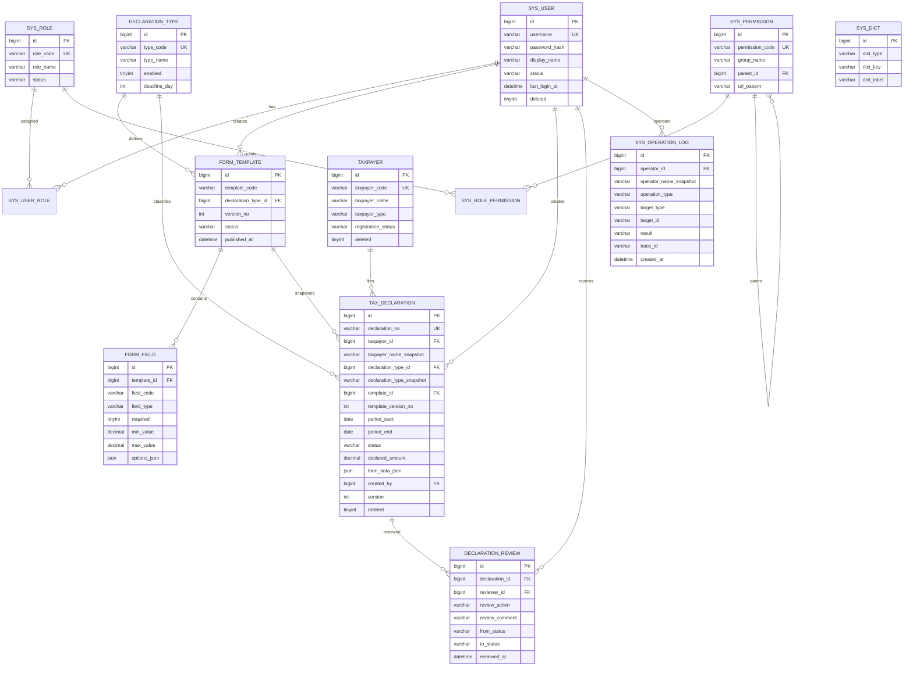
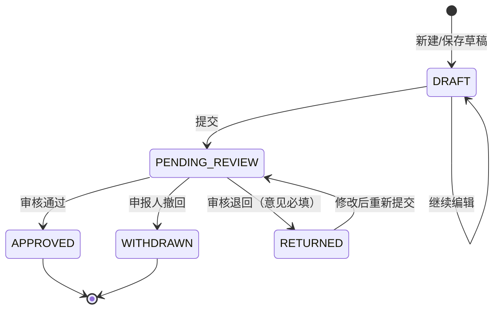
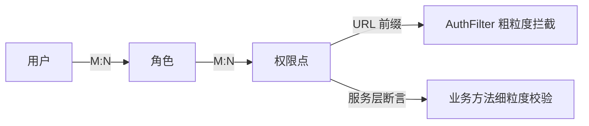

# 数据库设计说明

- 数据库：MySQL 8.0
- 字符集/排序规则：`utf8mb4` / `utf8mb4_0900_ai_ci`
- 存储引擎：InnoDB（支持事务、行级锁、外键）
- 脚本：`database/schema.sql`（结构）、`database/seed-demo.sql`（演示数据）
- 测试库：JUnit 使用 H2 2.2.224 的 MySQL 兼容模式执行同构脚本 `src/test/resources/schema-h2.sql`、`seed-h2.sql`

> 说明：数据库语法固定为 MySQL 8.0。Docker Compose 使用 MySQL 8.0.46，并自动执行 `schema.sql` 与 `seed-demo.sql`；Service 与 DAO 另由 30 个自动化测试使用 H2 MySQL 兼容模式回归验证。

## 1. 设计目标

1. 覆盖九大模块：工作台、用户/角色/权限、纳税人、申报类型、表单模板、申报、审核、统计、综合查询与审计。
2. 申报数据可追溯：纳税人名称、申报类型名称、模板版本在申报单上留快照。
3. 状态流转可审计：每次审核写入独立审核记录，关键操作写入操作日志。
4. 不做无法追溯的硬删除：业务表使用 `deleted` 软删除或状态字段；审核记录、日志不随业务删除。
5. 金额使用 `DECIMAL(18,2)`，禁止浮点。
6. 查询可命中索引：列表页的纳税人、状态、期间、创建人、提交时间均有索引支撑。

## 2. ER 图



## 3. 表清单

| 表名 | 用途 | 关键约束/索引 |
| --- | --- | --- |
| `sys_user` | 登录账号、BCrypt 摘要、状态 | `username` 唯一；`(status, deleted)` |
| `sys_role` | 角色 ADMIN/CLERK/REVIEWER/ANALYST/VIEWER | `role_code` 唯一 |
| `sys_permission` | 权限点，含分组与 URL 前缀 | `permission_code` 唯一；自关联父级 |
| `sys_user_role` | 用户-角色 M:N | 复合主键；双向索引 |
| `sys_role_permission` | 角色-权限 M:N | 复合主键；双向索引 |
| `taxpayer` | 纳税人档案 | `taxpayer_code` 唯一；名称索引；类型+状态索引 |
| `declaration_type` | 申报类型/税种 | `type_code` 唯一 |
| `form_template` | 模板主表，同编码多版本 | `(template_code, version_no)` 唯一；`(type,status)` |
| `form_field` | 动态字段定义 | `(template_id, field_code)` 唯一；模板删除级联字段 |
| `tax_declaration` | 申报单 | `declaration_no` 唯一；纳税人+类型+期间索引；状态索引 |
| `declaration_review` | 审核历史 | 申报单+审核时间索引；随申报单级联删除（仅测试/清理场景） |
| `sys_operation_log` | 操作审计 | 时间、类型、操作人索引；操作人删除时置空 |
| `sys_dict` | 枚举展示字典 | `(dict_type, dict_key)` 唯一 |

## 4. 关键设计决策

### 4.1 为什么保存名称与版本快照

`tax_declaration` 同时保存：

- `taxpayer_id` + `taxpayer_name_snapshot`
- `declaration_type_id` + `declaration_type_snapshot`
- `template_id` + `template_version_no`

原因：

- 纳税人改名、申报类型改名后，历史申报仍应显示提交时的名称。
- 模板会发布新版本；申报单必须能定位到当时使用的字段定义，否则旧数据无法解释。
- 外键仍保留，用于关联查询；快照用于展示与审计，两者不冲突。

### 4.2 动态表单数据

`form_data_json` 以 `field_code` 为键保存用户填写值：

```json
{
  "sales_amount": "100000.00",
  "deductible_amount": "20000.00",
  "tax_method": "一般计税",
  "declaration_cycle": "月度",
  "has_contract": "true",
  "remark": "演示草稿"
}
```

- 字段定义在 `form_field`，校验规则（必填、长度、数值范围、选项）由服务端读取模板后执行。
- 金额汇总只读取字段类型为 `AMOUNT` 的字段，累加得到 `declared_amount`。
- JSON 便于模板演进；同时保留 `declared_amount` 冗余列，统计查询无需解析 JSON。
- 不把动态字段拆成 EAV 表，避免列表/统计查询复杂化；课程项目数据量下 JSON 足够。

### 4.3 申报状态机



约束：

1. 仅 `DRAFT`、`RETURNED` 可编辑。
2. 仅 `DRAFT`、`RETURNED` 可提交；提交后写 `submitted_at`，版本号加一。
3. 仅 `PENDING_REVIEW` 可撤回、可审核。
4. 同一纳税人 + 同一申报类型 + 同一所属期，只能存在一条“活动”申报（`DRAFT/PENDING_REVIEW/RETURNED/APPROVED`）；`WITHDRAWN` 不占用名额。
5. 审核人不能审核自己创建的申报。
6. 审核通过/退回使用条件更新：`UPDATE ... WHERE id=? AND status='PENDING_REVIEW' AND version=?`，受影响行数为 0 视为并发冲突。
7. 所有状态变更在一个事务内完成：更新申报单 + 插入审核记录 + 写操作日志。

### 4.4 唯一性与并发

数据库层没有对“活动申报”建部分唯一索引（MySQL 不支持带 `WHERE` 的部分索引），因此在服务层事务中：

1. `SELECT ... FOR UPDATE` 锁定同纳税人/类型/期间的活动申报。
2. 若存在则拒绝。
3. 否则插入/更新。

H2 测试覆盖了重复提交被拒绝（DECL-02）。生产环境若并发量高，可增加“活动申报占位表 + 唯一索引”作为强化方案。

### 4.5 软删除与留痕

- `sys_user`、`taxpayer`、`tax_declaration` 有 `deleted` 标记；列表查询默认过滤。
- 业务上不物理删除已提交申报；撤回是状态变更，不是删除。
- `declaration_review` 的级联删除只用于测试数据清理；生产不应删除申报单。
- `sys_operation_log.operator_id` 使用 `ON DELETE SET NULL`，同时保存 `operator_name_snapshot`，即使用户被清理也能追溯操作人名称。

### 4.6 金额与精度

- 所有金额列 `DECIMAL(18,2)`。
- Java 使用 `BigDecimal`，比较用 `compareTo`，禁止 `double`。
- 汇总金额在服务层按模板字段类型累加，写入 `declared_amount`；统计查询直接 `SUM(declared_amount)`。

## 5. 索引与典型查询

| 查询场景 | SQL 条件 | 命中索引 |
| --- | --- | --- |
| 登录 | `username = ? AND deleted = 0` | `uk_user_username` |
| 用户列表 | `status = ? AND deleted = 0` | `idx_user_status` |
| 纳税人搜索 | `taxpayer_name LIKE ?` / `taxpayer_code = ?` | `idx_taxpayer_name` / 唯一键 |
| 申报列表（申报人） | `created_by = ? AND deleted = 0` | `idx_declaration_creator` |
| 申报列表（状态） | `status = ? AND deleted = 0` | `idx_declaration_status` |
| 重复申报检查 | `taxpayer_id=? AND declaration_type_id=? AND period_start=? AND period_end=?` | `idx_declaration_taxpayer_period` |
| 待审核列表 | `status='PENDING_REVIEW' AND deleted=0 ORDER BY submitted_at` | `idx_declaration_status` + `idx_declaration_submitted` |
| 审核历史 | `declaration_id = ? ORDER BY reviewed_at` | `idx_review_declaration` |
| 审计列表 | `created_at BETWEEN ? AND ?` | `idx_log_created` |
| 统计按月 | `submitted_at >= ?` 后应用层分组 | `idx_declaration_submitted` |

模糊搜索使用 `LIKE '%关键字%'`，无法命中普通 B-Tree 索引；演示数据量下可接受。数据量大时应引入全文索引或搜索引擎，本项目不超出课程范围。

## 6. 权限模型



- 角色是权限集合，不在代码里写死“某某角色可以做什么”。
- `AuthFilter` 做 URL 级粗过滤；Service 再做业务级校验（例如审核人不得审核自己的申报、分析师不能导出）。
- ADMIN 默认拥有系统管理权限，但**不包含** `review:manage`，因此管理员不能代替审核员审批。这是刻意设计，测试 PERM-03 覆盖。

## 7. 演示数据

`seed-demo.sql` 提供：

- 5 个角色、15 个权限点、6 个用户（含 1 个停用账号）。
- 6 个虚构纳税人（编号 `DEMO-*`，不涉及真实企业信息）。
- 4 个申报类型：增值税、企业所得税、个人所得税、印花税。
- 5 个模板版本（含同一模板的 v1 已发布、v2 草稿）。
- 23 个模板字段，覆盖 TEXT/INTEGER/AMOUNT/DATE/RADIO/MULTI/BOOLEAN。
- 12 张申报单，覆盖 5 种状态；6 条审核记录；10 条审计日志；12 条字典。

演示账号与密码见 README，均为虚构账号；密码以 BCrypt 摘要存储。

## 8. 验证状态

| 项目 | 状态 | 说明 |
| --- | --- | --- |
| MySQL 8 DDL 语法 | 待本机验证 | 无本机 MySQL 凭据，未执行 |
| H2 MySQL 模式建表 | 已通过 | 30 个测试每次重建库 |
| 外键/唯一约束 | 已通过 | 重复编号、重复提交、并发审核测试覆盖 |
| 事务回滚 | 已通过 | 审核失败不产生半成品记录 |
| 索引效果 | 未压测 | 仅按查询条件设计，未做大数量执行计划对比 |

后续如获得 MySQL 账号，应执行：

```bash
mysql -u <user> -p < database/schema.sql
mysql -u <user> -p tax_demo < database/seed-demo.sql
```

并抽查 `SHOW CREATE TABLE tax_declaration` 与 `EXPLAIN` 结果。
