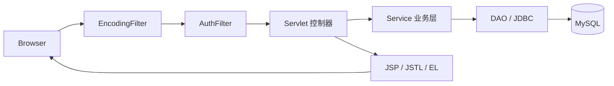
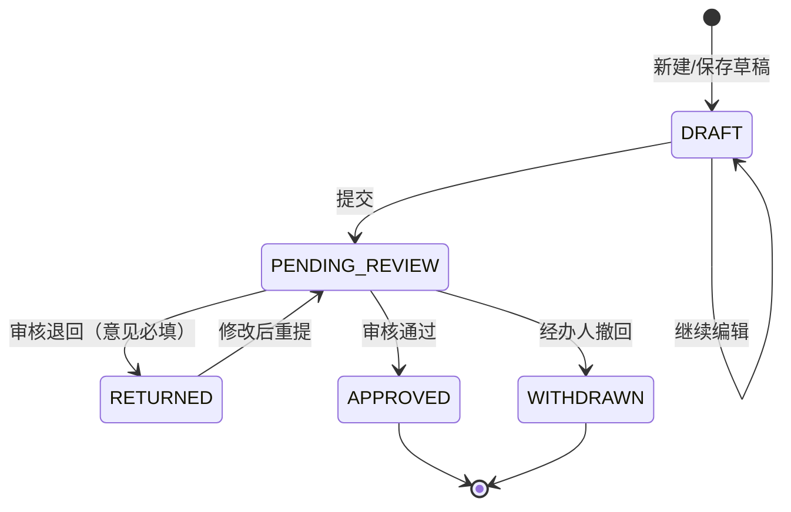

# 税务业务管理系统开发文档 V1.0（实现版）

- 版本：V1.0
- 日期：2026-10-29
- 架构：Servlet + JSP + JDBC + MySQL，Maven WAR，Tomcat 9
- 代码基线：`javax.servlet` 4.0 / JSP 2.3 / Java 11 字节码
- 业务声明：仅用于课程教学，全部纳税人、金额、申报数据均为虚构，不连接真实税务机关，不构成税务法律意见。

## 1. 项目概述

### 1.1 建设目标

把“权限 / 申报 / 统计 / 表单 / 查询”扩展为可运行、可演示、可测试的传统 Java Web 系统，形成完整闭环：

```text
登录 → 纳税人/类型/模板准备 → 经办人填报 → 提交
     → 审核通过 / 退回 → 经办人修改重提 → 统计与查询 → 审计追溯
```

### 1.2 交付范围

| 类别 | 内容 |
| --- | --- |
| 功能 | 工作台、用户/角色/权限、纳税人、申报类型、表单模板与版本、申报流转、审核、统计、综合查询、CSV 导出、审计、字典、个人中心 |
| 数据 | 13 张表、索引、外键、演示数据 |
| 代码 | 16 个 Servlet 类（含 `BaseServlet`）、11 个 Service、11 个 DAO、2 个 Filter、JSP 视图与本地静态资源 |
| 测试 | 11 个 JUnit 测试类、30 个用例；Tomcat 9 部署验证；13 张界面截图 |
| 文档 | 开发文档、UI 调研、数据库设计、路由清单、测试计划、变更记录、README |

不在范围内：真实税务接口、缴税/支付、电子签章、CA、发票、真实企业数据、微服务、Spring Boot、Vue/React、工作流引擎。

### 1.3 成功标准与达成情况

| 标准 | 状态 |
| --- | --- |
| 本地 Tomcat 9 启动，按 README 初始化数据库 | 已用 H2 验证部署；MySQL 实库待凭据 |
| 完成“登录—填报—提交—审核—统计查询”闭环 | 已通过自动化与页面验证 |
| 未授权 URL/POST 被服务端拒绝 | 已通过 403/401 验证 |
| 业务规则在 Service/数据库校验，不只靠 JS | 已实现 |
| 页面无死链、核心按钮有效、统计来自数据库 | 已验证主要页面与按钮 |
| 核心功能有可重复测试、使用虚构数据 | 30 个自动化用例 + 手工用例 |

## 2. 技术基线与兼容策略

### 2.1 固定版本

| 组件 | 版本 | 说明 |
| --- | --- | --- |
| Java | 11 | Eclipse Temurin 11 构建和运行，`maven.compiler.release=11` |
| Servlet API | 4.0.1 | `javax.servlet:javax.servlet-api`，`provided` |
| JSP API | 2.3.3 | `javax.servlet.jsp:javax.servlet.jsp-api`，`provided` |
| JSTL | 1.2 | 运行期打包 |
| Tomcat | 9.0.123 | 验证实例；生产需 9.0.x |
| MySQL | 8.0 | 由 Docker Compose 自动初始化和持久化 |
| HikariCP | 4.0.3 | 连接池 |
| MySQL Connector/J | 8.0.33 | JDBC 驱动 |
| jBCrypt | 0.4 | 密码哈希 |
| Gson | 2.11.0 | JSON |
| Bootstrap | 5.3 | 本地静态资源 |
| Chart.js | 4.4.3 | 本地静态资源 |
| JUnit | 5.10.2 | 测试 |
| H2 | 2.2.224 | 仅测试/验证，MySQL 模式 |

### 2.2 兼容性硬约束

- 只使用 `javax.servlet.*`，依赖树保持 Java EE 8 兼容。
- 不使用 Tomcat 10/11 部署本项目。
- 不混用 Spring/MyBatis/Hibernate/JPA。
- Maven 打包为 WAR，`failOnMissingWebXml=false`，使用注解式 Servlet/Filter。
- 金额统一 `BigDecimal` + `DECIMAL(18,2)`，禁止 `double`。

### 2.3 依赖选择理由

| 依赖 | 理由 |
| --- | --- |
| HikariCP | 轻量、成熟；相比容器 JNDI 更易在课程环境复现 |
| Gson | 只做动态表单 JSON 与图表数据序列化，不引入 ORM |
| jBCrypt | 专注 BCrypt，API 简单；成本因子 10 |
| H2 | 无 MySQL 凭据时仍能执行真实 SQL 与事务测试 |

## 3. 总体架构

### 3.1 分层



| 层 | 职责 | 禁止 |
| --- | --- | --- |
| Filter | 编码、TraceId、安全响应头、登录态、URL 权限、CSRF | 业务查询 |
| Servlet | 参数解析、调用 Service、设置 attribute、forward/redirect | 写 SQL、写业务规则 |
| Service | 权限、校验、事务、状态机、审计 | 直接输出 HTML |
| DAO | PreparedStatement、行映射、聚合查询 | 业务判断 |
| JSP | 只读展示、JSTL 循环/条件、EL 取值 | JDBC、scriptlet、SQL |

### 3.2 包结构

```text
com.example.tax
├── dao/          Jdbc, UserDao, RoleDao, PermissionDao, TaxpayerDao,
│                 DeclarationTypeDao, FormTemplateDao, DeclarationDao,
│                 ReviewDao, AuditLogDao, DictDao
├── dto/          Page, DeclarationFilter, TaxpayerFilter, UserFilter,
│                 AuditLogFilter, DeclarationForm, FieldInput, StatisticsSummary,
│                 MonthlyPoint, StatusCount, TypeAmount
├── exception/    AppException, BusinessException, ValidationException,
│                 ForbiddenException, NotFoundException
├── filter/       EncodingFilter, AuthFilter
├── model/        User, Role, Permission, Taxpayer, DeclarationType,
│                 FormTemplate, FormField, TaxDeclaration, DeclarationReview,
│                 OperationLog, Dictionary
├── security/     SessionUser, CsrfUtil, PermissionCodes, PasswordUtil
├── service/      AuthService, UserService, RoleService, TaxpayerService,
│                 DeclarationTypeService, FormTemplateService,
│                 DeclarationService, ReviewService, StatisticsService,
│                 SystemService, AuditService
├── servlet/      BaseServlet + 15 个业务 Servlet
└── util/         Db, WebUtil, CsvUtil, DateUtil, JsonUtil, ValidationUtil
```

> `Jdbc` 实际位于 `dao` 包，作为 DAO 的 SQL 辅助类。

### 3.3 请求处理约定

1. `EncodingFilter` 最先执行：设置 UTF-8、生成 16 位 TraceId、写入安全响应头。
2. `AuthFilter` 判断静态资源、登录页、会话、权限、CSRF。
3. Servlet 只做参数转换与流程编排，业务异常统一交给 `BaseServlet` 处理。
4. 成功写操作使用 `WebUtil.redirectWithSuccess` → 302 → 目标页显示 flash。
5. JSP 通过 `head.jspf` / `sidebar.jspf` / `topbar.jspf` / `footer.jspf` 组合布局。
6. 所有 JSP 位于 `WEB-INF/views`，外部无法直接请求。

## 4. 数据库实现

完整 ER 图、索引与字段说明见 `docs/database-design.md`。本节只列实现要点。

### 4.1 表清单

| 表 | 作用 |
| --- | --- |
| `sys_user` | 用户、BCrypt 摘要、状态、最近登录 |
| `sys_role` | 角色 |
| `sys_permission` | 权限点、分组、URL 前缀 |
| `sys_user_role` | 用户-角色 |
| `sys_role_permission` | 角色-权限 |
| `taxpayer` | 纳税人档案 |
| `declaration_type` | 申报类型 |
| `form_template` | 模板主表（同编码多版本） |
| `form_field` | 动态字段定义 |
| `tax_declaration` | 申报单、快照、表单 JSON、乐观锁 version |
| `declaration_review` | 审核历史 |
| `sys_operation_log` | 操作审计 |
| `sys_dict` | 枚举字典 |

### 4.2 快照策略

申报单保存：

- `taxpayer_name_snapshot`
- `declaration_type_snapshot`
- `template_id` + `template_version_no`

即使纳税人/类型改名、模板升级，历史申报仍按提交时名称与字段解释展示。外键继续保留用于关联与完整性。

### 4.3 动态表单

- 字段定义：`field_code`、`field_label`、`field_type`、`required`、`min_value`、`max_value`、`max_length`、`options_json`、`sort_order`。
- 申报值：`form_data_json`，键为 `field_code`，值为字符串。
- 提交时按模板字段逐项校验：必填、长度、整数、金额范围、日期格式、选项白名单。
- 金额字段汇总到 `declared_amount`，统计与列表不解析 JSON。
- 模板发布后不可原位修改；修改必须“新建版本”。

### 4.4 事务与并发

审核事务示意：

```java
connection.setAutoCommit(false);
try {
    TaxDeclaration current = declarationDao.findByIdForUpdate(connection, id);
    if (current == null || !current.isPending()) {
        throw new BusinessException("申报状态已变化，请刷新后重试");
    }
    if (current.getCreatedBy() == reviewer.getId()) {
        throw new ForbiddenException("不能审核自己创建的申报");
    }
    int updated = declarationDao.updateStatus(connection, id,
            "APPROVED", reviewer.getId(), current.getVersion());
    if (updated == 0) {
        throw new BusinessException("申报状态已变化，请刷新后重试");
    }
    reviewDao.insert(connection, review);
    auditService.record(connection, reviewer, "REVIEW_APPROVE", ...);
    connection.commit();
} catch (RuntimeException | SQLException e) {
    connection.rollback();
    throw e;
} finally {
    connection.setAutoCommit(true);
}
```

关键点：

- 条件更新 `WHERE id=? AND status='PENDING_REVIEW' AND version=?`，受影响行数 0 即并发冲突。
- 审核单、状态、审计日志同事务提交，避免“状态变了但没有审核记录”。
- 所有连接/语句/结果集使用 try-with-resources。

## 5. 权限与安全实现

### 5.1 角色与权限

| 角色 | 权限范围（实际种子） |
| --- | --- |
| ADMIN | 工作台、用户/角色、纳税人、类型、模板、申报查看/新建/提交、统计、审计、字典、导出；**不含审核** |
| CLERK | 工作台、纳税人查看、申报查看/新建/提交 |
| REVIEWER | 工作台、纳税人查看、申报查看、审核 |
| ANALYST | 工作台、纳税人查看、申报查看、统计、导出 |
| VIEWER | 工作台、申报查看（只读） |

权限不写死为“角色 if/else”，而是：

```text
sys_user → sys_user_role → sys_role → sys_role_permission → sys_permission
```

登录时加载权限编码集合到 `SessionUser`；`AuthFilter` 按 URL 前缀做粗过滤，Service 再做业务校验。管理员默认无 `review:manage`，防止管理员代替审核员审批，测试 PERM-03 覆盖。

### 5.2 认证与会话

- 密码 BCrypt cost 10；数据库只存 `password_hash`。
- 登录成功先 `request.changeSessionId()`，再写入 `currentUser`，防会话固定。
- 登录失败统一提示“账号或密码错误”；停用账号单独提示；未知账号与密码错误文案一致，降低枚举风险。
- 会话 Cookie `HttpOnly`；生产 HTTPS 时应加 `Secure`（由容器配置）。
- 退出使用 POST + CSRF，记录日志后 `session.invalidate()`；GET 退出只重定向，不变更状态。
- 会话超时由 Tomcat 配置控制，应用不保存密码。

### 5.3 CSRF

- `CsrfUtil.getToken(session)` 生成随机 Token，存 Session。
- 所有状态变更 POST 由 `AuthFilter` 校验；比较使用常量时间算法。
- JSP 表单隐藏域 `${csrfToken}`；登录页同样带 Token。
- 缺失/错误返回 403 错误页，不执行后续业务。

### 5.4 SQL 注入与 XSS

- 所有值使用 `PreparedStatement` 参数绑定；动态 SQL 只拼接固定片段与白名单排序。
- JSP 使用 `<c:out>` 输出用户数据；表单回显同样转义。
- 动态字段选项来自模板配置，不执行配置中的 JS/SQL/表达式。
- CSP：`default-src 'self'`，脚本仅允许本地资源；无内联事件处理器。

### 5.5 错误与日志

- `BaseServlet` 统一捕获：
  - `ValidationException` → 表单回显 + 字段错误（400/200）
  - `ForbiddenException` → 403 页面
  - `NotFoundException` → 404 页面
  - `SQLException` / 其他 → 500 页面，仅显示 TraceId
- 服务端日志记录异常堆栈与 TraceId；页面不输出 SQL、路径、堆栈。
- 审计日志字段：操作人、操作类型、对象、结果、摘要、TraceId、时间。
- 明确禁止写入：密码、Cookie、Session ID、CSRF Token、完整敏感表单。

### 5.6 导出安全

- 仅 `export:declaration` 权限可导出。
- 导出沿用当前筛选条件与用户数据范围。
- 最多 5000 行。
- UTF-8 BOM；RFC 4180 转义；公式前缀 `= + - @` 加 `'`。
- 导出写审计日志。

## 6. 功能模块实现

### 6.1 工作台

- 控制器：`DashboardServlet`。
- 数据：`StatisticsService.summary(user, 6)` + `DeclarationService.list(user, filter, 1, 6)`。
- KPI：总数、待审核、通过数、金额合计、我的草稿、我的退回、撤回、退回总数。
- 图表：近 6 个月趋势、状态环图、按类型金额；Chart.js 本地加载。
- 数据范围：分析师/管理员/审核员看全量；经办人/只读用户只看本人创建的数据（`StatisticsService.scopeCreator`）。
- 空数据时图表仍渲染空坐标，页面不报错。

### 6.2 用户、角色与权限

- `UserServlet`：列表、编辑、保存、启停、重置密码。
- `RoleServlet`：角色列表、权限勾选、保存、启停。
- 用户名校验唯一；停用用户不能登录；不能停用自己。
- 角色权限保存使用事务：先删旧关联再批量插入。
- 角色权限编辑页按 `group_name` 分组展示，避免一长串复选框。
- 重置密码生成临时密码，仅在 flash 中显示一次；数据库存 BCrypt 摘要。

### 6.3 纳税人

- `TaxpayerServlet`：列表、创建、编辑、详情、保存、启停。
- 字段校验：编号必填/唯一、名称必填、类型枚举、登记状态枚举、联系方式长度。
- 停用后 `DeclarationService` 在保存草稿时拒绝。
- 详情页展示该纳税人最近申报，便于追溯。

### 6.4 申报类型

- `DeclarationTypeServlet`：列表、编辑、保存、启停。
- 编码唯一；停用类型不能用于新建申报。
- 类型改名不影响历史申报，因为申报单保存 `declaration_type_snapshot`。

### 6.5 表单模板与版本

- `FormTemplateServlet`：列表、编辑、预览、版本历史、保存、发布、停用、新建版本。
- 字段类型：TEXT / INTEGER / AMOUNT / DATE / RADIO / MULTI / BOOLEAN。
- 字段校验规则在 `FormTemplateService.validateInputs`：
  - 编码格式与唯一性
  - 数值范围 min ≤ max
  - 单选/多选必须有选项
  - 文本长度上限
- 发布：同类型同编码只保留一个 PUBLISHED 版本，其余自动停用。
- 新建版本：复制当前模板与字段，版本号 +1，状态 DRAFT。
- 已发布/停用模板禁止原位修改，Service 抛 `BusinessException`。

### 6.6 申报

- `DeclarationServlet`：列表、新建、编辑、详情、保存、提交、撤回。
- 新建流程：
  1. 选择纳税人、类型、期间；切换类型时页面重载已发布模板。
  2. 服务端按模板渲染字段；字段名 `field_<code>`。
  3. 保存草稿时校验纳税人/类型状态、期间、动态字段、重复活动申报。
  4. 生成唯一 `declaration_no`（日期 + 随机/序列片段）。
- 提交：仅 DRAFT/RETURNED；事务内再次检查重复；写 `submitted_at`，`version+1`。
- 撤回：仅 PENDING_REVIEW；状态改为 WITHDRAWN。
- 已通过/已撤回不可编辑；详情页按状态隐藏编辑/提交按钮。
- 表单校验失败时回显输入，字段级错误显示在字段下方。

### 6.7 审核

- `ReviewServlet`：待审核列表、详情、通过、退回。
- 详情页展示：申报摘要、动态表单内容、审核历史时间线。
- 通过：可选意见；退回：意见必填。
- 审核人不能审核自己创建的申报。
- 条件更新 + 事务 + 审计；并发冲突提示刷新重试。
- 审核历史记录 from/to 状态、审核人、意见、时间。

### 6.8 统计

- `StatisticsService` 使用 SQL 聚合，不把全表拉到 Java：
  - `COUNT(*) GROUP BY status`
  - `SUM(declared_amount)`
  - `GROUP BY YEAR(created_at), MONTH(created_at)`
  - 按类型/主体类型 `JOIN + GROUP BY + SUM`
- 通过率 = 通过 /（通过 + 退回），分母为 0 显示 `—`。
- 月度趋势补齐缺失月份为 0，保证图表 X 轴连续。
- 金额统计排除 WITHDRAWN。
- 页面标注“模拟金额”“教学演示”。

### 6.9 综合查询、导出、审计

- `SearchServlet` 支持：关键字（申报编号/纳税人编号/名称）、纳税人、类型、状态、期间、经办人、提交日期范围、分页。
- 数据范围：CLERK 只看本人；REVIEWER/ANALYST/ADMIN 看全量。
- CSV 导出使用同一筛选条件；权限与行数限制；审计留痕。
- `AuditLogServlet` 支持操作类型、结果、时间、关键字筛选。
- 审计日志只读，无删除/修改入口。

### 6.10 个人中心与字典

- `/profile` 展示账号、显示名、角色、最近登录；修改密码需旧密码 + 新密码 + 确认。
- 新密码长度/复杂度在 `UserService` 校验；修改后写审计。
- `/admin/dictionaries` 维护字典项，供状态/类型标签统一展示。

## 7. 状态机



| 当前 | 操作 | 目标 | 校验 |
| --- | --- | --- | --- |
| DRAFT | 保存 | DRAFT | 创建人、模板有效、字段合法 |
| DRAFT | 提交 | PENDING_REVIEW | 无重复活动申报、字段完整 |
| RETURNED | 保存 | RETURNED | 创建人、字段合法 |
| RETURNED | 提交 | PENDING_REVIEW | 重新校验重复与字段 |
| PENDING_REVIEW | 通过 | APPROVED | 有审核权限、非本人、version 匹配 |
| PENDING_REVIEW | 退回 | RETURNED | 意见必填、version 匹配 |
| PENDING_REVIEW | 撤回 | WITHDRAWN | 创建人、尚未审核 |
| APPROVED | 编辑/撤回 | 禁止 | — |
| WITHDRAWN | 编辑/恢复 | 禁止 | 需重新申报则新建 |

“活动申报”定义：`DRAFT/PENDING_REVIEW/RETURNED/APPROVED`。同一纳税人 + 类型 + 期间只允许一条；WITHDRAWN 不占用名额。

## 8. UI 实现

### 8.1 设计语言

- 左侧深蓝导航 + 顶部浅色栏 + 内容区浅灰背景。
- 主色 `#1f4e79`，辅助墨绿 `#2f6f5e`；警告琥珀、危险砖红。
- 卡片白底、1px 边框、4px 圆角、轻阴影；不使用渐变/大图/玻璃拟态。
- 表格紧凑、数字右对齐、金额千分位；状态用“文字 + 颜色点”徽标。
- 目标视口 1366×768、1440×900；窄屏侧栏折叠、表格横向滚动。

### 8.2 页面清单

| 页面 | JSP |
| --- | --- |
| 登录 | `auth/login.jsp` |
| 工作台 | `dashboard.jsp` |
| 我的申报 | `declarations/list.jsp` |
| 新建/编辑申报 | `declarations/form.jsp` |
| 申报详情 | `declarations/detail.jsp` |
| 待审核 | `reviews/pending.jsp` |
| 审核详情 | `reviews/detail.jsp` |
| 综合查询 | `search.jsp` |
| 统计 | `statistics.jsp` |
| 纳税人列表/表单/详情 | `taxpayers/*.jsp` |
| 申报类型 | `declaration-types/*.jsp` |
| 表单模板列表/编辑/预览/版本 | `form-templates/*.jsp` |
| 用户/角色/审计/字典 | `admin/*.jsp` |
| 个人中心 | `profile.jsp` |
| 错误页 | `error/403.jsp`、`404.jsp`、`500.jsp` |

### 8.3 可访问性与交互

- 当前菜单 `aria-current="page"`；按钮有明确文字，不只靠图标。
- 表单字段使用 `<label for>`；必填项有 `*` 与说明。
- 删除/提交/审核等关键操作使用 `data-confirm` 二次确认。
- 表格空状态显示“暂无数据”，不显示假行。
- 状态徽标同时有文字，颜色仅辅助。
- 调研与取舍详见 `docs/ui-reference-research.md`；未实现的错误摘要锚点跳转已标注。

### 8.4 图表

- 本地 `chart.umd.min.js`，仅页面 `extraScript == 'charts.js'` 时加载。
- 仪表盘：折线、环图、横向条形图。
- 统计页：折线、环图、按类型/主体类型条形图。
- 金额使用 `Intl.NumberFormat("zh-CN")`；图表容器固定高度，避免布局抖动。

## 9. 配置与部署

### 9.1 数据库配置解析顺序

`Db.buildDataSource()`：

1. JVM 系统属性：`tax.db.url`、`tax.db.username`、`tax.db.password`、`tax.db.driver`、`tax.db.pool.maximum`、`tax.db.pool.minimum`
2. 类路径 `db.properties`
3. 默认值（仅用于本地开发，生产必须显式配置）

连接池懒加载：登录页/错误页不触发数据库连接，数据库暂时不可用时仍可显示错误提示。

### 9.2 构建

```bash
mvn clean test     # 30 个测试
mvn clean package  # target/tax-business-system.war
```

### 9.3 部署

1. 执行 `database/schema.sql`、`database/seed-demo.sql`。
2. 配置 `db.properties` 或 `CATALINA_OPTS`。
3. 复制 WAR 到 `$CATALINA_HOME/webapps/`。
4. 启动 Tomcat 9，访问 `/tax-business-system/`。
5. 用演示账号登录，按 README 的演示路径操作。

### 9.4 本机验证记录

- Tomcat 9.0.123 解压至独立目录，端口 18080。
- 使用 H2 文件库（MySQL 模式）注入 `tax.db.*` 系统属性，未修改生产代码。
- 启动日志：`Server startup in [2516] milliseconds`。
- 页面、权限、CSRF、状态流转结果见 `docs/test-plan.md` 第 5 节。
- 验证中发现并修复：JSP 片段乱码、Chart.js 未加载、侧边栏缺少 `aria-current`。

## 10. 测试与质量

### 10.1 自动化

- 11 个测试类、30 个用例，全部通过。
- 每个测试使用独立 H2 内存库，重建 schema + seed，避免状态泄漏。
- 覆盖：登录、停用、权限、CSRF 相关服务、纳税人、申报状态机、审核并发/自审、统计口径与数据范围、查询、审计、CSV 转义。

### 10.2 手工/页面

- 角色路由矩阵：CLERK/REVIEWER/ANALYST 的 200/403 结果符合预期。
- 安全：SQL 注入登录失败、停用账号拒绝、CSRF 缺失 403、GET 退出不失效。
- 流程：草稿保存 → 提交 → 审核通过 → 待审核列表移除；中文审核意见正确显示。
- 截图：11 张，覆盖登录、工作台、列表、统计、表单、详情、审核。

### 10.3 未覆盖

- MySQL 实库执行（无凭据）。
- 多浏览器/移动端真机、性能压测、专业渗透。
- 登录失败频率限制（需求列为 P1，V1.0 未实现）。

## 11. 已知问题与后续计划

| 问题 | 影响 | 计划 |
| --- | --- | --- |
| MySQL 实库未验证 | 部署前需自行执行 DDL | 获得账号后跑 schema/seed + 冒烟 |
| 统计在应用层补月份 | 大数据量下仍需优化 | 数据量大时用递归 CTE/日历表 |
| 活动申报唯一性依赖服务层事务 | 极高并发下可能竞争 | 增加占位表 + 唯一索引 |
| 错误摘要无锚点跳转 | 可访问性不完整 | 按 GOV.UK 模式补错误摘要与聚焦 |
| 无登录失败频率限制 | 暴力破解风险 | 增加 IP/账号维度限流与锁定 |
| 未做数据导出异步化 | 大导出可能占用请求线程 | 限制行数已缓解；后续可异步任务 |

## 12. 关键文件索引

| 文件 | 说明 |
| --- | --- |
| `pom.xml` | 依赖、Java 11、WAR 构建 |
| `database/schema.sql` | MySQL 8 建表 |
| `database/seed-demo.sql` | 虚构演示数据 |
| `src/main/java/.../filter/AuthFilter.java` | 登录、权限、CSRF |
| `src/main/java/.../service/DeclarationService.java` | 申报状态机 |
| `src/main/java/.../service/ReviewService.java` | 审核事务 |
| `src/main/java/.../service/StatisticsService.java` | 统计口径与数据范围 |
| `src/main/java/.../dao/DeclarationDao.java` | 申报 SQL 与聚合 |
| `src/main/webapp/WEB-INF/views/` | 全部 JSP |
| `src/test/java/...` | 30 个测试 |
| `docs/` | 交付文档 |
