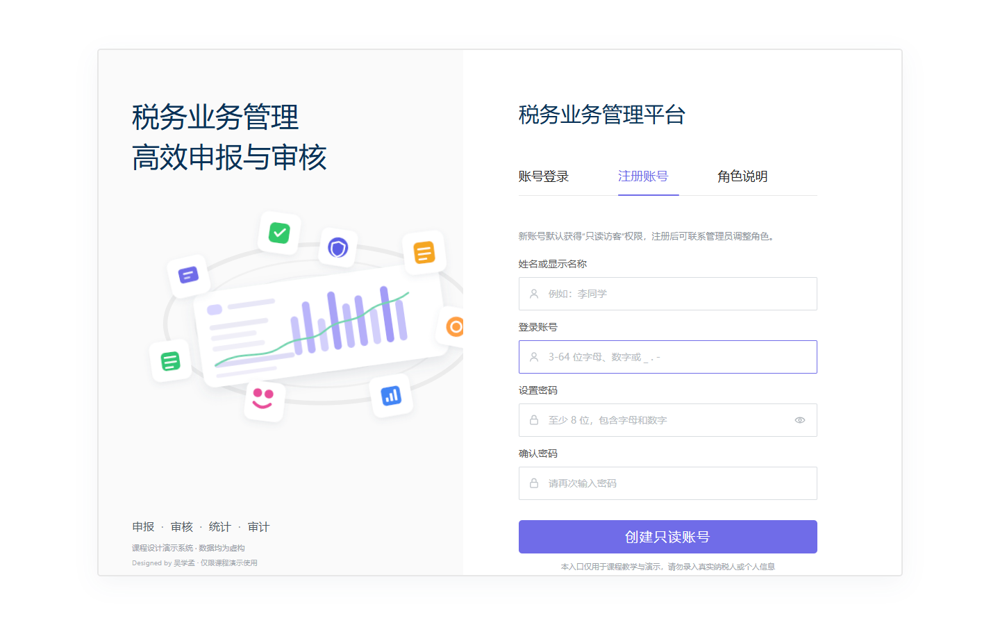

# 税务业务管理系统（传统 Java EE 版）部署文档

> **作者：24软工2班 吴学孟 24110741085**

## 文档说明

本文档对应目录：

```text
税务业务管理-传统javaee版
```

**传统版用于完成教学课程要求，采用 Struts 6、JSP、Servlet、JDBC 和 MySQL，不使用 Spring Boot 和 Vue。项目严格使用 `javax.servlet` 命名空间，必须部署到 Tomcat 9，不能部署到 Tomcat 10/11。**

本文档提供两种部署方式：

1. **Docker 一键部署（推荐）**：自动启动 MySQL 8 和 Tomcat 9，自动建库并导入演示数据。
2. **传统本地部署**：手工安装 JDK、Maven、MySQL、Tomcat，构建 WAR 后部署。

返回项目总说明：[项目说明.md](<../项目说明.md>)

---

## 一、项目技术栈与软件版本

### 1. 核心技术栈

| 层次 | 技术 | 项目版本或约束 |
| --- | --- | --- |
| Java 编译目标 | Java | 11 |
| 本地推荐 JDK | OpenJDK / Oracle JDK | 11 或 17 |
| Docker 构建 JDK | Eclipse Temurin | 17 |
| Docker 运行 JDK | Eclipse Temurin | 17 |
| Web 容器 | Apache Tomcat | 9.0.123 |
| Web 控制器 | Apache Struts | 6.12.0 |
| Servlet API | `javax.servlet-api` | 4.0.1 |
| JSP API | `javax.servlet.jsp-api` | 2.3.3 |
| JSTL | JSTL | 1.2 |
| 视图 | JSP 2.3 + JSTL + EL | 服务端渲染 |
| 数据访问 | JDBC + PreparedStatement + 手写 DAO | 不使用 ORM/MyBatis |
| 数据库 | MySQL | 8.0（Docker 镜像 `mysql:8.0`） |
| JDBC 驱动 | MySQL Connector/J | 8.0.33 |
| 连接池 | HikariCP | 4.0.3 |
| 密码摘要 | jBCrypt | 0.4 |
| JSON | Gson | 2.11.0 |
| 日志 | SLF4J | 1.7.36 |
| Log4j API 实现 | Log4j Core | 2.26.1 |
| 前端样式 | Bootstrap | 5.3 |
| 图表 | Chart.js | 4.x |
| 构建工具 | Apache Maven | 3.9.x（Docker 使用 3.9.9） |
| 打包格式 | WAR | `target/tax-business-system.war` |
| 自动化测试 | JUnit 5 + H2 | JUnit 5.10.2 / H2 2.2.224 |
| 一键编排 | Docker Compose | Compose V2 |

### 2. 已验证环境

项目实际完成过以下 Docker 环境验证：

| 软件 | 验证版本 |
| --- | --- |
| Docker Engine | 29.9.2 |
| Docker Compose | v5.6.1 |
| MySQL | 8.0.46 |
| Tomcat | 9.0.123 |
| JDK（容器运行时） | Eclipse Temurin 17 |

### 3. 技术边界

- 传统版没有使用 Spring Boot、Vue、React、MyBatis、Hibernate 或 JPA。
- 所有 Java Web API 使用 `javax.servlet`，不使用 `jakarta.servlet`。
- 不使用 Struts 7；Struts 7 已面向 Jakarta。
- `web.xml` 部署描述符版本为 Java EE 8 / Servlet 4.0。
- 业务地址统一使用 `.action` 后缀，由 `struts.xml` 映射。

---

## 二、Docker 一键部署（推荐）

### 1. 准备工作

需要安装 Docker Desktop。Windows 用户安装后启动 Docker Desktop，并等待其状态显示为 `Engine running`。

在 PowerShell 中检查：

```powershell
docker --version
docker compose version
docker info
```

三条命令均能正常返回后，才能继续启动项目。

### 2. 使用一键 Docker 运行 `.bat`

进入项目根目录：

```text
E:\2026-2\Java EE\税务业务管理-传统javaee版
```

直接双击：

```text
START.bat
```

也可以双击：

```text
docker-start.bat
```

两个文件的功能相同，`START.bat` 是推荐入口，`docker-start.bat` 是兼容入口。

启动脚本实际执行：

```text
START.bat
  → scripts\start-docker.ps1
  → docker compose up -d --build
  → 等待 Tomcat / Struts 登录页响应
  → 输出容器状态和演示账号
  → 自动打开浏览器
```

脚本会自动完成：

1. 检查 Docker 命令。
2. 检查 Docker Engine 是否运行。
3. 检查 Docker Compose V2。
4. 构建 Maven + WAR + Tomcat 9 应用镜像。
5. 启动 MySQL 8。
6. 等待 MySQL 健康检查通过。
7. 启动 Tomcat 9 应用容器。
8. 等待 `auth/login.action` 返回正常页面。
9. 显示容器状态并打开系统页面。

登录页提供同一行的“账号登录 / 注册账号 / 角色说明”三个页签。自助注册仅创建只读访客账号，不开放管理员、经办人、审核员或分析师角色。



首次执行需要下载 Maven、JDK、MySQL 基础镜像和依赖，耗时较长属于正常现象。后续构建会复用 Maven 缓存，速度会明显提高。

### 3. 命令行启动

如果不使用 `.bat`，可以在项目根目录执行：

```powershell
docker compose up -d --build
```

查看状态：

```powershell
docker compose ps
```

查看应用日志：

```powershell
docker compose logs -f --tail=200 app
```

查看数据库日志：

```powershell
docker compose logs -f --tail=200 mysql
```

停止容器但保留数据库：

```powershell
docker compose down
```

### 4. 默认访问地址

| 服务 | 地址 |
| --- | --- |
| 系统主页 | <http://localhost:18082> |
| 登录页 | <http://localhost:18082/auth/login.action> |
| MySQL | 仅 Docker 内部网络访问，不开放宿主机端口 |

默认端口选择 `18082`，是为了与旁边的 Spring Boot 版 `18080` 错开。

### 5. Docker 容器与数据卷

| 名称 | 用途 |
| --- | --- |
| `tax-jee-mysql` | MySQL 8 数据库容器 |
| `tax-jee-app` | Tomcat 9 + Struts 应用容器 |
| `tax-business-jee-network` | 两个容器的内部网络 |
| `tax-business-jee-mysql-data` | MySQL 持久化数据卷 |

首次创建 MySQL 数据卷时，容器会自动执行：

```text
database/schema.sql
database/seed-demo.sql
```

因此 Docker 首次启动不需要手工建库、建表或导入演示数据。

### 6. 修改端口和数据库密码

复制环境变量示例：

```powershell
Copy-Item .env.docker.example .env
```

编辑 `.env`：

```dotenv
APP_PORT=18082
MYSQL_DATABASE=tax_demo
MYSQL_USER=tax_app
MYSQL_PASSWORD=TaxDemo_2026
MYSQL_ROOT_PASSWORD=TaxRoot_2026
```

如需修改页面端口，只改 `APP_PORT`。例如改为 `28082`：

```dotenv
APP_PORT=28082
```

重新执行 `START.bat`，访问：

```text
http://localhost:28082
```

`.env` 已加入 `.gitignore`，不要提交真实密码。

### 7. 停止、重启和更新

停止但保留数据：

```powershell
docker compose down
```

重新启动：

```powershell
docker compose start
```

修改 Java、JSP、CSS 或配置后重新构建：

```powershell
docker compose up -d --build
```

也可以在 PowerShell 中执行：

```powershell
powershell.exe -NoProfile -ExecutionPolicy Bypass -File .\scripts\start-docker.ps1
```

不自动打开浏览器：

```powershell
powershell.exe -NoProfile -ExecutionPolicy Bypass -File .\scripts\start-docker.ps1 -NoBrowser
```

### 8. 清空并恢复演示数据

执行：

```powershell
docker compose down
```

不会删除数据库。下一次会继续使用原数据卷。

如需彻底重置演示数据：

```powershell
docker compose down -v
docker compose up -d --build
```

> 警告：`down -v` 会删除 `tax-business-jee-mysql-data`，历史数据不可恢复。只应在确定需要恢复初始演示数据时使用。

---

## 三、传统本地部署流程

### 1. 安装前置软件

需要：

- JDK 11 或 17。
- Maven 3.9.x。
- MySQL 8.0。
- Apache Tomcat 9.0.x。

检查命令：

```powershell
java -version
mvn -version
mysql --version
```

Tomcat 必须是 9.0.x。Tomcat 10/11 使用 `jakarta.*`，与传统版的 `javax.servlet` 不兼容。

### 2. 初始化 MySQL 数据库

在项目根目录打开 `cmd.exe` 或 Git Bash，执行：

```cmd
mysql -u root -p < database\schema.sql
mysql -u root -p tax_demo < database\seed-demo.sql
```

PowerShell 不支持直接使用 `<` 重定向，因此可以在 PowerShell 中执行：

```powershell
cmd /c "mysql -u root -p < database\schema.sql"
cmd /c "mysql -u root -p tax_demo < database\seed-demo.sql"
```

登录 MySQL：

```powershell
mysql -u root -p
```

创建应用账号，密码请自行替换：

```sql
CREATE USER 'tax_app'@'localhost' IDENTIFIED BY 'ChangeMe_Local_2026';
GRANT SELECT, INSERT, UPDATE, DELETE ON tax_demo.* TO 'tax_app'@'localhost';
FLUSH PRIVILEGES;
```

验证：

```sql
USE tax_demo;
SHOW TABLES;
SELECT COUNT(*) FROM sys_user;
SELECT COUNT(*) FROM tax_declaration;
```

### 3. 配置数据库连接

项目读取顺序：

1. JVM 系统属性，例如 `-Dtax.db.url=...`。
2. 环境变量 `TAX_DB_*`。
3. 类路径中的 `db.properties`。
4. 内置默认值。

#### 方式 A：使用 `db.properties`（推荐本地部署）

复制模板：

```powershell
Copy-Item src\main\resources\db.properties.example `
  src\main\resources\db.properties
```

编辑 `src\main\resources\db.properties`：

```properties
db.url=jdbc:mysql://localhost:3306/tax_demo?useUnicode=true&characterEncoding=UTF-8&serverTimezone=Asia/Shanghai&useSSL=false&allowPublicKeyRetrieval=true
db.username=tax_app
db.password=ChangeMe_Local_2026
db.driver=com.mysql.cj.jdbc.Driver
db.pool.maximum=10
db.pool.minimum=2
```

`db.properties` 已被 `.gitignore` 忽略。修改该文件后需要重新执行 Maven 打包，使配置进入 WAR。

#### 方式 B：环境变量

PowerShell：

```powershell
$env:TAX_DB_URL="jdbc:mysql://localhost:3306/tax_demo?useUnicode=true&characterEncoding=UTF-8&serverTimezone=Asia/Shanghai&useSSL=false&allowPublicKeyRetrieval=true"
$env:TAX_DB_USERNAME="tax_app"
$env:TAX_DB_PASSWORD="ChangeMe_Local_2026"
```

环境变量必须在启动 Tomcat 的同一个终端中设置，或写入 Tomcat 的 `bin\setenv.bat`。

#### 方式 C：Tomcat JVM 参数

在 `%CATALINA_HOME%\bin` 下新建 `setenv.bat`：

```bat
set "CATALINA_OPTS=-Dfile.encoding=UTF-8 -Duser.timezone=Asia/Shanghai -Dtax.db.url=jdbc:mysql://localhost:3306/tax_demo?useUnicode=true^&characterEncoding=UTF-8^&serverTimezone=Asia/Shanghai^&useSSL=false^&allowPublicKeyRetrieval=true -Dtax.db.username=tax_app -Dtax.db.password=ChangeMe_Local_2026"
```

> `&` 在 Windows 批处理中有特殊含义，所以必须写成 `^&`。

### 4. 执行自动化测试

项目使用 H2 模拟 MySQL，不需要启动 MySQL即可执行大部分 Service 测试：

```powershell
mvn clean test
```

预期：

```text
Tests run: 28, Failures: 0, Errors: 0, Skipped: 0
BUILD SUCCESS
```

### 5. 构建 WAR

```powershell
mvn clean package
```

产物：

```text
target\tax-business-system.war
```

### 6. 部署到 Tomcat 9

先停止 Tomcat。然后将 WAR 复制到 Tomcat 的 `webapps` 目录。

#### 方式 A：使用项目名访问

```powershell
Copy-Item target\tax-business-system.war `
  "$env:CATALINA_HOME\webapps\tax-business-system.war"
```

访问：

```text
http://localhost:8080/tax-business-system/
```

#### 方式 B：部署为根应用

复制并重命名：

```powershell
Copy-Item target\tax-business-system.war `
  "$env:CATALINA_HOME\webapps\ROOT.war"
```

访问：

```text
http://localhost:8080/
```

更新部署时，先停止 Tomcat，再替换 WAR。若 Tomcat 解压过旧目录，应确认旧目录已被新版本替换，避免继续加载旧 JSP 或旧类。

### 7. 启动 Tomcat

Windows：

```powershell
& "$env:CATALINA_HOME\bin\startup.bat"
```

Linux：

```bash
$CATALINA_HOME/bin/startup.sh
```

查看日志：

```powershell
Get-Content "$env:CATALINA_HOME\logs\catalina.*.log" -Wait -Tail 200
```

看到类似以下日志表示启动成功：

```text
Server startup in [xxxx] milliseconds
```

### 8. 验证本地部署

1. 打开登录页。
2. 使用 `admin / Admin@123` 登录。
3. 查看工作台是否加载图表和申报数据。
4. 打开“申报管理”“纳税人管理”“系统管理”等菜单。
5. 检查登录页地址是否以 `.action` 结尾。
6. 检查 CSV 导出和操作日志。

若部署为根应用，登录页为：

```text
http://localhost:8080/auth/login.action
```

若使用项目名部署，登录页为：

```text
http://localhost:8080/tax-business-system/auth/login.action
```

---

## 四、演示账号

| 账号 | 密码 | 角色 |
| --- | --- | --- |
| `admin` | `Admin@123` | 系统管理员 |
| `clerk1` | `Clerk@123` | 申报经办员 |
| `reviewer1` | `Reviewer@123` | 申报审核员 |
| `analyst1` | `Analyst@123` | 统计分析员 |
| `viewer1` | `Viewer@123` | 只读访客 |
| `disabled1` | `Disabled@123` | 停用账号，不能登录 |

以上密码仅用于教学演示。真实部署前必须重置或删除演示账号。

### 自助注册说明

- 登录页切换到“注册账号”页签。
- 填写显示名称、登录账号、密码和确认密码。
- 登录账号长度为 3-64 位，只允许字母、数字、下划线、点和短横线。
- 密码至少 8 位，必须同时包含字母和数字。
- 注册成功后返回“账号登录”并预填新账号。
- 新账号固定分配 `VIEWER` 角色，只能查看其被授权的只读数据。
- 重复账号、弱密码或两次密码不一致会被拒绝。

注册接口为 `/auth/register.action`，需要 CSRF Token；Docker 部署不需要额外配置。

---

## 五、常用配置

### Docker 配置 `.env`

| 变量 | 默认值 | 说明 |
| --- | --- | --- |
| `APP_PORT` | `18082` | 宿主机页面端口 |
| `MYSQL_DATABASE` | `tax_demo` | 数据库名 |
| `MYSQL_USER` | `tax_app` | 应用数据库账号 |
| `MYSQL_PASSWORD` | `TaxDemo_2026` | 应用数据库密码 |
| `MYSQL_ROOT_PASSWORD` | `TaxRoot_2026` | MySQL root 密码 |

### 本地配置

| 配置 | 默认值 | 说明 |
| --- | --- | --- |
| `tax.db.url` / `TAX_DB_URL` | `jdbc:mysql://localhost:3306/tax_demo...` | JDBC 地址 |
| `tax.db.username` / `TAX_DB_USERNAME` | `root` / `tax_app` | 数据库账号 |
| `tax.db.password` / `TAX_DB_PASSWORD` | 空 | 数据库密码 |
| `tax.db.pool.maximum` / `TAX_DB_POOL_MAXIMUM` | `10` | 最大连接数 |
| `tax.db.pool.minimum` / `TAX_DB_POOL_MINIMUM` | `2` | 最小空闲连接数 |

---

## 六、常用文件说明

| 文件 | 作用 |
| --- | --- |
| `START.bat` | Windows 推荐的 Docker 一键启动入口 |
| `docker-start.bat` | Docker 一键启动兼容入口 |
| `docker-stop.bat` | 停止并移除容器，保留数据卷 |
| `docker-logs.bat` | 实时查看 Docker 日志 |
| `scripts/start-docker.ps1` | 真正的启动、构建、健康检查和浏览器打开逻辑 |
| `Dockerfile` | Maven 构建 WAR，复制到 Tomcat 9 |
| `compose.yaml` | MySQL 8 + Tomcat 9 服务编排 |
| `.env.docker.example` | Docker 端口和数据库配置模板 |
| `struts.xml` | Struts 命名空间、Action 和 JSP Result |
| `database/schema.sql` | 数据库表结构 |
| `database/seed-demo.sql` | 演示账号与业务种子数据 |
| `src/main/resources/db.properties.example` | 本地数据库配置模板 |
| `target/tax-business-system.war` | Maven 构建产物 |

---

## 七、常见问题排查

### 1. 提示 `docker 不是命令`

Docker Desktop 未安装，或安装后当前终端未重新打开。重新启动终端并确认：

```powershell
docker --version
```

### 2. 提示 Docker Engine 未运行

打开 Docker Desktop，等待状态变为 `Engine running`。再执行：

```powershell
docker info
```

### 3. 18082 端口被占用

复制 `.env.docker.example` 为 `.env`，修改：

```dotenv
APP_PORT=28082
```

重新执行 `START.bat`。

### 4. 首次 Docker 启动较慢

首次要下载 JDK、Maven、MySQL 镜像并构建 WAR。后续会复用 Docker 层和 Maven cache mount，通常更快。

### 5. 修改代码后页面仍是旧内容

执行：

```powershell
docker compose up -d --build
```

然后强制刷新浏览器。

### 6. 登录页 404

传统版路由使用 `.action`，正确地址：

```text
http://localhost:18082/auth/login.action
```

不要使用旧的 `/auth/login` 无后缀地址。

### 7. 启动报 `ClassNotFoundException: javax.servlet.*`

部署到了 Tomcat 10/11。请换用 Tomcat 9.0.x。

### 8. 数据库连接失败

Docker 部署检查：

```powershell
docker compose ps
docker compose logs --tail=200 mysql
docker compose logs --tail=200 app
```

本地部署检查：

- MySQL 服务是否启动。
- `tax_demo` 是否已创建。
- `tax_app` 密码是否正确。
- JDBC URL 是否包含正确的时区、UTF-8 和 SSL 参数。
- 修改 `db.properties` 后是否重新打包 WAR。

### 9. 修改数据库密码后 Docker 登录失败

MySQL 数据卷会保留第一次初始化时的数据库账号密码。修改 `.env` 后旧数据卷不会自动修改密码。可以选择：

- 恢复原密码。
- 进入 MySQL 修改账号密码。
- 确认不需要旧数据后执行 `docker compose down -v`，重新初始化。

### 10. 中文乱码

确认：

- MySQL、数据库和表使用 `utf8mb4`。
- JDBC URL 使用 `characterEncoding=UTF-8`。
- Tomcat 使用 `-Dfile.encoding=UTF-8`。
- JSP 使用 UTF-8。

---

## 八、部署验收清单

- [ ] Docker Desktop 或本地 JDK/Maven/MySQL/Tomcat 已安装。
- [ ] 传统版使用 Tomcat 9，而不是 Tomcat 10/11。
- [ ] Docker 页面端口为 18082，或已正确修改 `.env`。
- [ ] MySQL 容器状态为 healthy。
- [ ] Tomcat 应用日志出现 `Server startup`。
- [ ] `/auth/login.action` 返回 HTTP 200。
- [ ] `admin / Admin@123` 可以登录。
- [ ] 工作台可以读取数据库数据。
- [ ] 申报、审核、统计和系统管理页面可以打开。
- [ ] CSV 导出正常。
- [ ] 容器重启后数据仍保留。
- [ ] 日志没有未处理异常。

---

**作者：24软工2班 吴学孟 24110741085**
